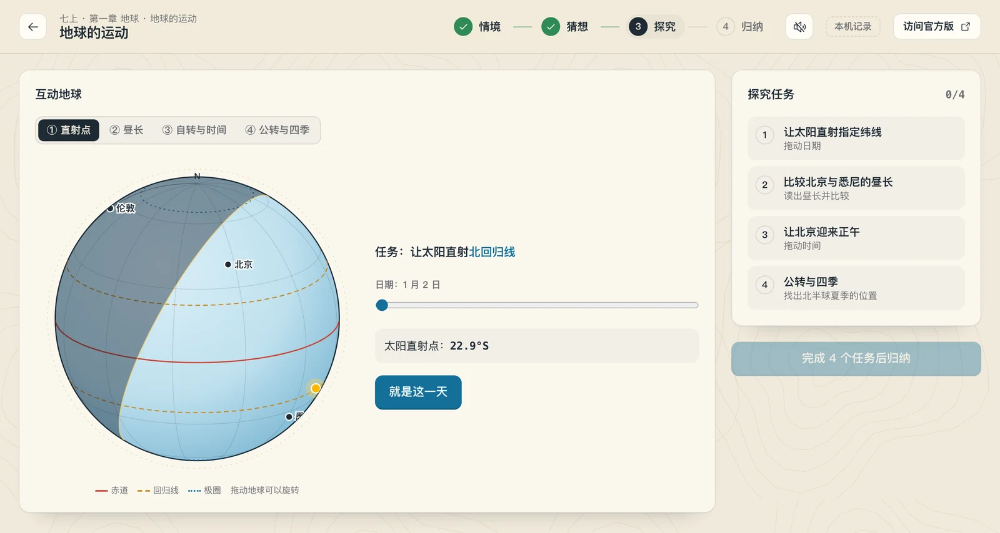

# 禾苗地理社区版

一个可以自行部署、免登录的地理探究工作台。学生可以转动地球仪观察昼夜，用等高线沙盘读地形，再去竞技场练习经纬度定位。

**[访问禾苗地理官方版](https://geography.hemiaoji.com/home)** · [快速开始](#快速开始) · [自托管部署](#自托管部署) · [版权与许可](#版权与许可)



## 快速开始

准备 **Node.js 22.18.0 或更新版本**和 **pnpm 11.19.0**。下载或克隆本仓库后，在项目目录运行以下命令。

```sh
pnpm install --frozen-lockfile
pnpm dev
```

打开 [localhost:3410](http://localhost:3410/home)，点击「开始探险」，或到「教材课程」挑一节课。默认配置下可以直接使用 14 节互动课和单机竞技场。

## 你可以在这里做什么

| 功能 | 体验 |
| --- | --- |
| 互动探究 | 从情境出发，提出猜想，动手验证，再归纳规律并完成巩固练习。比如拖动日期观察太阳直射点、比较北京和悉尼的昼长，或对照立体沙盘读等高线。 |
| 教材课程 | 4 册人教版初中地理课程路线，覆盖七年级和八年级上下册。另有 68 册初中、高中参考教材，可按学段和版本筛选并查看封面、目录和原书入口。 |
| 单机竞技场 | 「经纬度定位」每局 15 题，从看图读数、推理判断练到极地俯视。答题用时和连击影响得分，可以反复挑战自己的最高分。 |
| AI 地理向导 | 接入自有模型后，可以免登录问地理概念、追问现象原因或请向导出题。课件中的「问 AI」会带上当前小节。 |
| 学习首页 | 查看章节进度、星级和最近完成的探究，从上次所学的课程继续。支持纸面、夜间主题和课程音效开关。 |

社区版包含 33 节互动探究，其中 19 节依赖天地图标准底图，配置后即可使用。教材 PDF 由原资源提供方提供，仓库只保留阅读入口。

## 社区版与官方版

| 场景 | 选哪一个 |
| --- | --- |
| 学生想直接开始，或希望通过禾苗账号保存在线学习记录 | [打开禾苗地理官方版](https://geography.hemiaoji.com/home)。 |
| 老师、家长或开发者想在自己的环境运行，或基于源码调整课件 | 使用社区版。启动无需连接禾苗账号或数据库，学习记录、星级和竞技场成绩保存在当前浏览器。 |

社区版右上角的「访问官方版」会在新标签页打开。两个站点的学习记录各自保存。

## 自托管部署

在部署机器上的项目目录安装依赖并构建。启动时监听本机端口 3410，公开访问可通过反向代理接入域名和 HTTPS。

```sh
pnpm install --frozen-lockfile
pnpm build
pnpm start --hostname 127.0.0.1
```

### 配置站名与地图

默认配置可以直接运行。需要修改站名或开启地图时，复制 [`.env.example`](.env.example) 为本机配置文件。

```sh
cp .env.example .env.local
```

| 配置项 | 用途 |
| --- | --- |
| `NEXT_PUBLIC_SITE_NAME` | 侧栏和网页标题显示的站名。默认「禾苗地理社区版」。 |
| `NEXT_PUBLIC_TIANDITU_KEY` | 自行申请的天地图浏览器端 Key。按天地图控制台要求配置访问域名或 IP 白名单。 |
| `NEXT_PUBLIC_TIANDITU_CREDIT` | 实际使用的标准底图审图号，显示在地图下方的来源标注中。 |

同时填写天地图 Key 和审图号后，侧栏会显示「地图观察」，课程页会开放需要底图的探究。浏览器访问地图场景时会向天地图加载底图瓦片。修改配置后，开发环境重启服务，生产环境重新构建再启动。

### 配置 AI 地理向导

侧栏始终提供「AI 地理向导」。在部署环境或 `.env.local` 填写下列配置，再重启服务即可开启问答。

| 配置项 | 用途 |
| --- | --- |
| `GEOGRAPHY_AI_BASE_URL` | 兼容 OpenAI Chat Completions 接口的服务基地址，例如 `https://api.openai.com/v1`。应用会拼接 `/chat/completions`。 |
| `GEOGRAPHY_AI_MODEL` | 服务端实际提供的模型名称。 |
| `GEOGRAPHY_AI_API_KEY` | 模型服务需要认证时填写。Key 仅保存在部署端。 |

向导会把问题、近期对话和当前课节传给配置的模型服务。对话只保留在当前页面。公开站点配置付费模型时，请通过反向代理限制 `/api/ai/chat` 的请求频率，并设置模型服务的用量上限。

### 常见问题

- **为什么课程目录里有些条目打不开？** 目录保留了教材章节。已制作的探究可以进入，地图课会给出配置提示，其余章节以目录供查阅。
- **为什么换了部署地址后看不到旧进度？** 浏览器按站点地址保存进度。请在原设备的原浏览器访问旧地址。清除站点数据会删除该浏览器上的记录。
- **在哪里找教材原书？** 在参考教材详情页点击原书入口。部分来源需要登录其平台阅读。

## 开发与贡献

社区版使用 Next.js、React、TypeScript 和 Tailwind CSS。判分和竞技场出题逻辑可直接运行单元测试。

| 想改什么 | 从哪里看 |
| --- | --- |
| 章节、知识点和互动课清单 | [教材课程路线](src/data/catalog.ts) · [互动课清单](src/data/lessons.ts) · [参考教材](src/data/textbook-library.ts) |
| 探究页面、出题和验算 | [互动场景](src/components/lesson) · [题目与任务规则](src/lib/lessons.ts) · [判分验算](src/lib/verify.ts) |
| 经纬度竞技场 | [出题与计分](src/lib/arena) |
| 本机学习记录 | [进度存储](src/lib/progress.ts) |

提交课件改动时，请说明对应的教材与小节、如何复现，以及新增素材的来源和许可。已经发布的知识点 ID 用于关联本机学习记录，新增课件时请沿用原有 ID。

```sh
pnpm typecheck
pnpm lint
pnpm test
pnpm build
```

## 版权与许可

© 2026 禾苗地理项目贡献者。应用页脚提供「版权与许可」说明。

- **项目代码**采用 [Apache License 2.0](LICENSE)，保留随附的 [NOTICE](NOTICE)。
- **原创教学内容**采用 CC BY 4.0。复用原创课件、练习、示意图或封面时，请注明作者、来源、许可和改动。见[内容许可](CONTENT-LICENSE.md)。
- **教材原书、第三方资料和品牌**各自保留权利。天地图、WMO 气候观测数据和 Kenney 音效的来源及条款见[第三方声明](THIRD_PARTY_NOTICES.md)。禾苗名称、标识和宠物形象的品牌权利单独保留。
